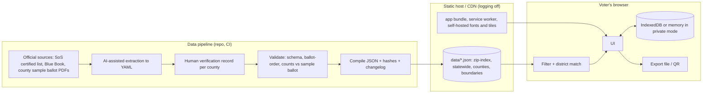

# Colorado Ballot Explorer: Technical Specification

Source: docs/prd.md · Status: draft for review · Generated by /anvil-spec

## Overview

A static, offline-capable web app with no application server. Ballot data is compiled at build time from human-verified source files into versioned JSON files: one statewide file, one all-counties file, and a small ZIP index. Every browser downloads the same files and does all filtering, district matching and storage on the device, so the host never learns what a voter looks up or decides, or which county they live in (NFR-01, AC-40). The key technical bet is that every county's ballot items together, without boundaries, fit in a file small enough to download on a phone (budget under 1.5 MB compressed), which makes "download everything, filter locally" practical. Boundaries for precise mode are a separate statewide file loaded only when precise mode is used.

## Architecture



Request flow for a lookup: the app loads `zip-index.json`, `statewide.json` and `counties.json` on first use, the same three files for every voter, and resolves the ZIP to counties and items locally. No request contains the ZIP, and no request varies with it.

County data delivery (critique D2). The pipeline still builds one source file per county, then concatenates them into `counties.json`. The build reports the compressed size and fails if it exceeds the 1.5 MB budget. If real data exceeds the budget, the fallback is a small fixed number of regional bundles (each covering several counties and a large share of the state's population), fetched by region, with that signal disclosed on the privacy page. Per-county fetching is not used. The pilot has only two verified counties, so the all-counties file is small; the first Release 1 milestone measures it with all 64 counties.

## Data model

All files carry `schema_version`, `data_version` and `election_id` so multiple elections (PRD Q3) can coexist.

```jsonc
// data/2026-11-03/zip-index.json
{ "schema_version": 1, "data_version": "2026.10.15-1", "election_id": "co-2026-11-03",
  "zips": { "80302": { "counties": ["08013"],
                       "districts": { "congressional": ["co-cd-2"], "state_senate": ["co-senate-15", "co-senate-18"],
                                      "state_house": ["co-house-10", "co-house-12", "co-house-49"], "place": ["city-boulder"] } } },
  "other_states": { "840": "UT" },                       // first three ZIP digits -> state, for REQ-02
  "states": { "UT": { "name": "Utah", "election_site": "https://..." } } }

// data/2026-11-03/statewide.json: items in printed order; ballot_order is spaced 1000 apart
{ "schema_version": 1, "data_version": "...", "election_id": "co-2026-11-03", "districts": [], "items": [ <item>, ... ] }

// data/2026-11-03/counties.json: every county, so every visitor fetches the same file (critique D2)
{ "schema_version": 1, "data_version": "...", "election_id": "co-2026-11-03",
  "counties": { "08013": {
    "county_fips": "08013", "name": "Boulder",
    "coverage": { "status": "verified_complete", "source": "https://...boulder sample ballot.pdf",
                  "verified_at": "2026-10-15", "verified_by": "Name" },     // or { "status": "statewide_only" }
    "statewide_order": [ "us-senate", "us-house-cd-2", ... ],   // statewide items on this county's ballots, in printed order
    "districts": [ { "id": "city-boulder", "type": "city", "name": "City of Boulder" } ],
    "items": [                                                 // local items; ballot_order falls between statewide items
      { "id": "city-of-boulder-2l", "kind": "measure", "group": "measures", "ballot_order": 37010,
        "district_id": "city-boulder", "title": "City of Boulder Ballot Question 2L",
        "ballot_text": { "text": "Shall the City Charter be amended ...", "source": "https://...sample ballot.pdf" },
        "choices": [ "For the Measure", "Against the Measure" ],   // only when the ballot does not print YES/FOR, NO/AGAINST
        "links": { "official": [], "explainers": [], "support": null, "oppose": null },
        "provenance": { "source": "https://...sample ballot.pdf", "verified_at": "2026-10-15" } },
      { "id": "city-of-boulder-council-candidates", "kind": "candidate_contest", "group": "city", "ballot_order": 15020,
        "district_id": "city-boulder", "title": "City of Boulder Council Candidates", "vote_for": 5, "ranked": false,
        "candidates": [ { "id": "cand-lee-gilbert", "name": "Lee Gilbert", "party": null, "order": 1, "links": [] } ],
        "write_in": false, "links": { ... }, "provenance": { ... } },
      { "id": "city-of-boulder-mayoral-candidates", "kind": "candidate_contest", "group": "city", "ballot_order": 15010,
        "district_id": "city-boulder", "title": "City of Boulder Mayoral Candidates", "ranked": true, "max_ranks": 6, "seats": 1,
        "rcv_instructions": { "text": "Rank candidates in the order of your preference ...", "source": "https://...sample ballot.pdf" },
        "candidates": [ ... ], "write_in": false, "links": { ... }, "provenance": { ... } }
    ] } } }
```

The app builds a county's ballot from `statewide_order` plus that county's `items`, sorted by `ballot_order`. A ZIP in several counties shows each county's ballot items, with one coverage label per county. District ids are `co-cd-N`, `co-senate-N`, `co-house-N`, `city-<name>` (from Census places) and a slug of the district's printed name for special districts. `provenance.verified_at` and `coverage` come from the signed verification record, never from source files.

`statewide.json` has the same `items` shape with `group` in federal, state, judges (statewide courts) and measures. `kind` is one of `measure`, `retention`, `candidate_contest`. A ranked contest has `ranked: true`, `max_ranks` (the number of ranking columns on the printed ballot), `seats` (1 for single-winner) and `rcv_instructions`, copied from the jurisdiction's official voter instructions; it has no `vote_for`. Every `measure` carries `ballot_text` copied from the certified source; there is no field for project-written descriptions (critique D3). When the certified title includes a table (Colorado requires one for income tax changes, as in Amendment 87), `ballot_text.table` holds its caption, header, rows and note. `choices` is present only when the ballot prints labels other than YES/FOR and NO/AGAINST: two labels take the yes and no positions; more than two make a pick-one question (REQ-09). Every `retention` item has a `links.official` entry labeled "Judicial performance evaluation" pointing to the Colorado Office of Judicial Performance Evaluation page for that judge, and no field for the evaluation's finding (critique D4).

User data (device only):

```jsonc
{ "format": "ballot-explorer-choices", "version": 1, "election_id": "co-2026-11-03",
  "scope": { "zip": "80302", "narrowing": { "co-house": "10" } },
  "choices": { "boulder-city-2c": { "vote": "yes" }, "boulder-council": { "selected": ["cand-a","cand-c"] },
               "boulder-mayor": { "ranking": ["cand-b", "cand-a", { "write_in": "Name" }] } },   // array index 0 = 1st
  "notes": { "boulder-city-2c": "Ask Dana about the fiscal note" },
  "updated_at": "2026-10-13T18:00:00Z" }
```

Saved file (`.ballot`, C6). Only the header is readable; the user-data JSON above is inside `ciphertext`:

```jsonc
{ "format": "ballot-explorer-encrypted", "version": 1,
  "kdf": { "name": "PBKDF2-SHA-256", "iterations": 600000, "salt": "<base64>" },
  "wrapped_keys": { "code": { "iv": "<base64>", "key": "<base64>" },
                    "device": { "iv": "<base64>", "key": "<base64>" } },   // absent for private-session saves
  "iv": "<base64>", "ciphertext": "<base64>" }
```

The header carries no election, ZIP, date or device identifier.

## Components

### C1 Data pipeline (`pipeline/`)
Python 3.12, managed with uv. Extraction drafts the sources: `pipeline/import_sos.py` drafts `sources/<election>/statewide.yaml` from the Secretary of State's official candidate list, party drawing and certified measures page, and `pipeline/extract_sample_ballot.py` drafts `sources/<election>/<fips>.yaml` from a county's compiled sample ballot PDF. A county file lists the full ballot in printed order, referring to statewide items by id. A person corrects the drafts. A verification record (`verification/statewide.yaml`, `verification/<fips>.yaml`), filled in by people only, lists the source, checker, date, group counts in printed order as read from the source, each measure's certified text copied independently from the source, and a second person's spot check of at least 10 percent of items. Items get their verified date from this record. The compiler validates against JSON Schema, checks that group order and counts equal the verification record and that statewide references appear in statewide order, checks the spot check (second person, at least 10 percent), assigns ballot order, checks every measure's `ballot_text` against the certified text recorded in the verification record, checks every retention item has its evaluation link, checks every ranked contest has `rcv_instructions` with a source, `max_ranks` and `seats`, concatenates county files into `counties.json` and fails if it exceeds the size budget, emits JSON, the published schemas, `manifest.json`, SHA-256 hashes (`hashes.txt`) and `CHANGELOG.md` entries for every item added, removed or changed since the last build. `--check` fails if committed `data/` differs from what the sources compile to.
Implements: REQ-05, REQ-06 (retention links), REQ-08, REQ-10 (ranked contest fields), REQ-20, REQ-21, REQ-22 (changelog), NFR-01 (same files for everyone), NFR-06, NFR-07.

### C2 ZIP index builder (`pipeline/zip_index.py`)
Intersects Census cartographic ZCTA polygons with county, congressional, state senate, state house and place boundaries, and writes `sources/<election>/geo.json` (committed, so builds need no network). A ZIP touches a district when the overlap is at least 0.5 percent of the ZIP or 20 percent of the district; erring toward inclusion only adds items labeled "Depends on your district". ZCTAs approximate USPS ZIPs; the caveat is shown in research mode. Also derives a table of non-Colorado ZIP prefixes to states, and `sources/states.yaml` gives each state's election site. Special district boundaries (RTD, fire, metro and school districts) are not intersected, so their items always show as conditional.
Implements: REQ-01, REQ-02.

### C3 Ballot resolver (`app/src/resolve.ts`)
Pure functions. `rank(choice, candidateId)`, `unrank(choice, candidateId)` and `move(choice, candidateId, delta)` keep a ranking consecutive, unique and within `max_ranks` (AC-14). `itemsForZip(index, files, zip)` returns items with `conditional: districtName | null`. `narrow(items, selections)` removes items that cannot apply. `itemsForPoint(items, boundaries, [lon, lat])` uses point-in-polygon on TopoJSON boundaries from the statewide `boundaries.topojson` (Release 1, not in pilot). Always sorts by `ballot_order`.
Implements: REQ-01, REQ-03, REQ-04, REQ-05, REQ-10 (ranking rules), NFR-06.

### C4 UI (`app/src/ui/`)
Preact with TypeScript, built with Vite. Chosen for a small bundle (target under 60 KB compressed app JS) and familiar component model. Screens per design.md. Controls are native form elements where possible (radio group for Yes/Undecided/No, checkboxes for candidates) for accessibility. The progress bar (REQ-12) is a `position: sticky` header shared by the Ballot and item detail screens, using a native `<progress>` element plus the text count, derived from the store so it updates on every change. Scroll offsets for in-page links account for its height. The print stylesheet hides it.

Ranked-choice counting example (`app/src/ui/rcv-example.ts`, Release 1): fixed, hand-written example data with fictional candidates, one variant for single-winner and one for multi-winner contests. It is static content, never computed from loaded ballot data or the voter's choices (AC-48). The app has no tabulation code. The example's steps are checked against each pilot or release jurisdiction's official counting rules before release.
Implements: REQ-06, REQ-07, REQ-09, REQ-10, REQ-11, REQ-12, REQ-13, REQ-14, REQ-20, REQ-21, REQ-22 (report link), REQ-23, NFR-05, NFR-09.

### C5 Storage (`app/src/store.ts`)
One interface, two backends: IndexedDB (via a 1 KB wrapper written in-house, no dependency) and an in-memory backend for private session mode. Debounced autosave at 300 ms. `clearAll()` deletes the database (including the device key used by C6), Cache Storage entries for user data, and `localStorage` keys. On first save the store calls `navigator.storage.persist()` to reduce browser-initiated deletion, such as Safari's 7-day limit; the app works the same whether or not it is granted.
In private session mode, a `beforeunload` handler is registered while there is at least one decision or note, so the browser shows its own leave-page confirmation (browsers ignore custom text). iOS Safari does not reliably fire it when a tab closes, so the PrivacyStrip text in design.md is the primary warning and this prompt is a backup.
Implements: REQ-15, REQ-16, REQ-17.

### C6 Portability (`app/src/portable.ts`)
Export encrypts the user-data JSON and writes it as a `.ballot` download via a Blob URL. All cryptography uses the browser's Web Crypto API; no crypto library is added.

- A random 256-bit file key encrypts the JSON with AES-256-GCM.
- The file key is wrapped twice, and both wrapped copies go in the file header:
  - With a key derived from the code: PBKDF2-SHA-256, 600,000 iterations, random 16-byte salt. Works in any browser.
  - With a device key: a non-extractable AES-GCM `CryptoKey` created on first save and stored in IndexedDB. Page code can use it but cannot read or export it. Not created in private session mode, so private-mode files have only the code wrap.
- The code is five words chosen with `crypto.getRandomValues` from the EFF large word list (7,776 words, about 64 bits). The word list is vendored and loaded only when saving, so it does not count against the app bundle budget. Code entry ignores case and accepts spaces or hyphens between words.
- Import tries the device key first; if unwrapping fails, it asks for the code. A wrong code fails the AES-GCM integrity check and is reported as a wrong code, with no change to stored data.
- After decryption, import validates `format`, `version`, `election_id` and item IDs against loaded data; unknown IDs are dropped with a count shown.

Storing the device key in the browser adds no exposure: the same storage already holds the choices unencrypted. Files copied anywhere else still need the code. Export and import ship in Release 1, not in the pilot. QR (Release 1): compress JSON with deflate, encode across up to 4 QR codes if needed, generate with a vendored QR library, read with the browser camera via a vendored decoder. No network.
Implements: REQ-18, REQ-19, NFR-01.

### C7 Service worker (`app/src/sw.ts`)
Hand-written, no Workbox. Precaches the app shell on install. Caches the three ballot data files on first use, so every county works offline (cache-first, revalidate when online by comparing `data_version` against a tiny `manifest.json`). The boundaries file is cached only after precise mode is first used.
Implements: NFR-03, NFR-04.

### C8 Hosting and headers
Static host with request logging disabled or not retained (provider to be confirmed, Q7). Headers: `Content-Security-Policy: default-src 'self'; script-src 'self'; style-src 'self'; img-src 'self' data: blob:; connect-src 'self'; font-src 'self'; frame-ancestors 'none'; base-uri 'none'; form-action 'none'`, plus `Referrer-Policy: no-referrer`, `Permissions-Policy: geolocation=(self), camera=(self)`. Subresource Integrity on every script tag. No cookies are ever set.
Implements: NFR-01, NFR-02, NFR-08.

### C9 Error reporting and changelog
Release 1, not in the pilot (critique D6). "Report an error" offers both a prefilled `mailto:` to a corrections address and a link to a public GitHub issue template. Nothing is sent by the app itself. The report screen and the privacy page say what each channel exposes: email reveals the reporter's address to the project; a GitHub issue is public and needs a GitHub account. In the pilot, testers report errors directly during moderated sessions. The pipeline publishes `CHANGELOG.md` rendered as a page.
Implements: REQ-22.

## Requirement coverage

| ID | Implemented by | Verified by |
|---|---|---|
| REQ-01 | C2, C3 | Unit tests on resolver with fixture ZIPs; e2e AC-01, AC-02 |
| REQ-02 | C2, C4 | e2e AC-03 |
| REQ-03 | C3, C4 (Release 1) | Unit point-in-polygon tests; e2e AC-04, network assertion AC-05 |
| REQ-04 | C3, C4 | Unit tests on `narrow`; e2e AC-06 |
| REQ-05 | C1, C3 | Pipeline order check vs verification record; e2e AC-07 |
| REQ-06 | C1, C4 | Component tests AC-08, AC-41; pipeline retention link check |
| REQ-07 | C4 | Component test AC-09 |
| REQ-08 | C1, C4 | Pipeline fails on ballot text mismatch (AC-11); component test AC-10 |
| REQ-09 | C1, C4 | Component tests AC-12, AC-51, AC-52; schema check of `choices` |
| REQ-10 | C1, C3, C4 | Unit tests on ranking functions AC-14; component tests AC-13, AC-47, AC-48; e2e write-out AC-49; pipeline check AC-50 |
| REQ-11 | C4, C5 | e2e AC-15 |
| REQ-12 | C4 | Component test AC-16; e2e scroll test at 360 px AC-42 |
| REQ-13 | C4 | e2e AC-17, AC-18; print snapshot AC-19 |
| REQ-14 | C4 | Component test AC-20 |
| REQ-15 | C5 | e2e reload test AC-21 |
| REQ-16 | C5 | e2e AC-22 (inspect storage after clear); AC-45 (old file needs code after clear) |
| REQ-17 | C5, C6 | e2e AC-23 (assert no IndexedDB writes); AC-45 (private-session file needs code); AC-46 (Playwright Chromium asserts a beforeunload dialog) |
| REQ-18 | C6 | Unit round-trip, malformed-file and wrong-code tests AC-24, AC-25; file content scan AC-43; e2e same-browser and new-browser-context restore AC-44, AC-45 |
| REQ-19 | C6 (Release 1) | e2e with fake camera stream AC-26 |
| REQ-20 | C1, C4 | Pipeline coverage status; e2e AC-27 |
| REQ-21 | C1, C4 | Schema requires provenance; component test AC-28 |
| REQ-22 | C1, C9 | Link test AC-29; changelog generation test AC-30 |
| REQ-23 | C4 | Content review AC-31 |
| NFR-01 | C1, C3, C5, C6, C7, C8 | Playwright network guard on every e2e test AC-32, AC-05, AC-26; same-files test AC-40; saved-file content scan AC-43 |
| NFR-02 | C8 | Header test and cookie assertion AC-33 |
| NFR-03 | C7 | e2e offline test AC-34 |
| NFR-04 | C4, C7 | Lighthouse CI with mobile throttling AC-35 |
| NFR-05 | C4 | axe-core in e2e, manual VoiceOver and NVDA pass AC-36 |
| NFR-06 | C1, C3 | Order check in pipeline and e2e AC-07 |
| NFR-07 | C1 | Pipeline schema and hash checks AC-37, AC-11 |
| NFR-08 | C8 | Reproducible build job comparing hashes AC-38 |
| NFR-09 | C4 | Playwright at 360 px, no horizontal overflow AC-39 |

## Security and privacy

What exists where:
- On the host: app files and public ballot data only. No user data. Every visitor fetches the same data files, so file requests reveal nothing about county or district (critique D2). The host can still see that an IP address used the site and whether it loaded the boundaries file (meaning precise mode was used, not where). Logging is off or not retained. If the regional-bundle fallback is ever needed, the privacy page states that the host can infer region.
- On the device: choices, notes and the ZIP or narrowing scope, in IndexedDB or memory.
- In saved files: the same, encrypted (C6). Only the format header is readable. Write-out files saved from S6 are plain text by design, and the app says so.

Threats and mitigations:
- Shared devices: private session mode, Clear everything, a visible "saved on this device" indicator. Saved files left behind (for example in Downloads) need the code once Clear everything has run.
- Saved files leaving the device (cloud sync, email, messaging): encrypted with a generated code of about 64 bits, strong enough against offline guessing. The save screen tells voters not to send the code with the file.
- Tampered data or site: SRI, published hashes, reproducible build, provenance on every item.
- Look-alike sites: one canonical domain, hashes published in the repo README.
- Supply chain: minimal dependencies, all vendored or pinned with lockfile, `npm audit` in CI, no runtime CDN.
- Map tiles (Release 1): self-hosted vector tiles for Colorado only, served from the same origin.
- Geolocation: requested only when the voter taps "Use my location", never on load.

## Testing strategy

| Layer | Tool | Proves |
|---|---|---|
| Data validation | Python, jsonschema, custom order and count checks | AC-07, AC-11, AC-27, AC-28, AC-37, AC-50 |
| Unit | Vitest | Resolver (AC-01, AC-02, AC-06), ranking (AC-14), portability (AC-24, AC-25, AC-43), storage |
| Component | Vitest + Testing Library | AC-08 to AC-10, AC-12, AC-13, AC-16, AC-20, AC-41, AC-47, AC-48, AC-51, AC-52 |
| End to end | Playwright (mobile Chromium, WebKit) | Flows AC-01 to AC-07, AC-15, AC-17 to AC-19, AC-21 to AC-23, AC-34, AC-39, AC-42, AC-44 to AC-46, AC-49 (a fresh browser context stands in for another browser) |
| Privacy guard | Playwright route handler that fails the test on any off-origin request or any request whose URL or body contains the test ZIP, coordinates or note text; a second test looks up ZIPs in different counties and asserts identical request lists | AC-05, AC-26, AC-32, AC-33, AC-40 |
| Accessibility | axe-core in Playwright, manual screen-reader script | AC-36 |
| Performance | Lighthouse CI, mobile preset | AC-35 |
| Build | Rebuild in clean container, compare hashes | AC-38 |
| Data accuracy | Human verification record per county, second-person spot check of 10 percent of items | Coverage claim in REQ-20 |

## Tooling and deployment

- Node 22, TypeScript 5, Vite 6, Preact 10, Vitest, Playwright, Lighthouse CI. Python 3.12 for the pipeline via uv (jsonschema, pyyaml, shapely and pyshp for build-time geometry, openpyxl for the Secretary of State's spreadsheets).
- Monorepo: `pipeline/`, `sources/`, `verification/`, `app/`, `data/` (build output, committed for transparency).
- CI on GitHub Actions: pipeline validate, unit, component, e2e with privacy guard, axe, Lighthouse, hash publish.
- Deploy: Vercel (owner decision, 2026-10-14), static output from the `main` branch build after CI passes. Headers via `vercel.json`. Vercel Web Analytics and Speed Insights stay off (they inject scripts). Vercel keeps its own request logs; M4 records what it logs and for how long, and the privacy page says so (NFR-01, Q7).

## Risks

| Risk | Likelihood | Impact | Mitigation |
|---|---|---|---|
| Pilot scope too large to build between October 13 and the October 16 pilot start | High | Medium | Pilot is invited testers only (critique D1); cut REQ-07 and guided narrowing polish before cutting the privacy guard or verification |
| Extraction errors in local items | Medium | High | Human verification with count checks; second-person spot check; visible error reporting |
| ZCTA vs USPS ZIP mismatch causes wrong county or missing items | Medium | Medium | Always show conditional labels; guided narrowing; note on the caveat |
| All-counties file exceeds the 1.5 MB budget once all 64 counties are verified | Medium | Medium | Build fails on size; measure in the first Release 1 milestone; fall back to regional bundles with disclosure |
| Voters lose the code, then lose browser data, and cannot restore | Medium | Low | Same-browser restore needs no code; save screen requires an "I've saved the code" step and offers Copy; a ballot plan can be rebuilt in minutes |
| Boundary data too large for phones (Release 1) | Medium | Medium | Simplify geometry to about 10 m tolerance; load boundaries only in precise mode |
| Host injects scripts or headers we don't control | Low | High | Header and resource tests run against production after each deploy |

## Open questions

- Which host meets the logging requirement, and can it be verified? (PRD Q7)
- Where do official district boundary files come from for each district type, and how current are they after 2021 redistricting and city annexations?
- Does any county publish per-precinct ballot styles in machine-readable form? That would replace much of the ZCTA approximation.
- QR capacity: is a full ballot with notes small enough for 4 codes? Measure with real Boulder data.
- What is the compressed size of `counties.json` with all 64 counties verified? Decides whether the regional-bundle fallback is needed.
