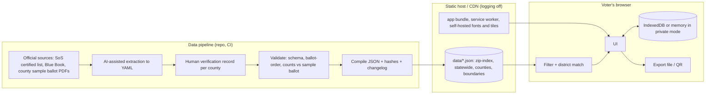

# Colorado Ballot Explorer: Technical Specification

Source: docs/prd.md · Status: draft for review · Generated by /anvil-spec

## Overview

A static, offline-capable web app with no application server. Ballot data is compiled at build time from human-verified source files into versioned JSON files: one statewide file, one all-counties file, and a small ZIP index. Every browser downloads the same files and does all filtering, district matching and storage on the device, so the host never learns what a voter looks up or decides, or which county they live in (NFR-01, AC-40). The key technical bet is that every county's ballot items together, without boundaries, fit in a file small enough to download on a phone (budget under 1.5 MB compressed), which makes "download everything, filter locally" practical. Boundaries for precise mode are a separate statewide file loaded only when precise mode is used.

## Architecture



Request flow for a lookup: the app loads `zip-index.json`, `statewide.json` and `counties.json` on first use, the same three files for every voter, and resolves the ZIP to counties and items locally. No request contains the ZIP, and no request varies with it.

County data delivery (critique D2). The pipeline still builds one source file per county, then concatenates them into `counties.json`. The build reports the compressed size and fails if it exceeds the 1.5 MB budget. If real data exceeds the budget, the fallback is a small fixed number of regional bundles (each covering several counties and a large share of the state's population), fetched by region, with that signal disclosed on the privacy page. Per-county fetching is not used. The pilot has only two verified counties, so the all-counties file is small; the first Release 1 milestone measures it with all 64 counties.

## Data model

All files carry `schema_version`, `data_version` and `election_id` so multiple elections (PRD Q3) can coexist.

```jsonc
// data/2026-11-03/zip-index.json
{ "schema_version": 1, "election_id": "co-2026-11-03",
  "zips": { "80302": { "counties": ["08013"], "districts": { "co-house": ["10","13"], "co-senate": ["18"] } } } }

// data/2026-11-03/counties.json holds { "schema_version": 1, "data_version": "...", "counties": { "08013": <county object>, ... } }
// County object for Boulder (built from sources/co-2026-11-03/08013.yaml):
{ "schema_version": 1, "data_version": "2026.10.12-1", "county_fips": "08013",
  "coverage": { "status": "verified_complete", "source": "https://...boulder sample ballot.pdf", "verified_at": "2026-09-28", "verified_by": "reviewer-id" },
  "districts": [ { "id": "co-house-10", "type": "state_house", "name": "State House District 10",
                   "geometry_ref": "boundaries/08013.topojson#co-house-10" } ],
  "items": [
    { "id": "boulder-city-2c", "kind": "measure", "group": "city", "ballot_order": 4120,
      "district_id": "city-boulder", "title": "Ballot Question 2C",
      "ballot_text": { "text": "Shall the City of Boulder ...", "source": "https://...boulder sample ballot.pdf" },
      "links": { "official": [ {"label": "Full text", "url": "..."} ], "explainers": [],
                 "support": {"label": "...", "url": "..."}, "oppose": null },
      "provenance": { "source": "https://...", "verified_at": "2026-09-28" } },
    { "id": "boulder-council", "kind": "candidate_contest", "group": "city", "ballot_order": 4010,
      "district_id": "city-boulder", "title": "City Council", "vote_for": 5, "ranked": false,
      "candidates": [ { "name": "...", "party": null, "order": 1, "links": [ {"label": "Campaign site", "url": "..."} ] } ],
      "write_in": true, "provenance": { "source": "...", "verified_at": "2026-09-28" } }
  ] }
```

`statewide.json` has the same `items` shape with `group` in federal, state, judges (statewide courts) and measures. `kind` is one of `measure`, `retention`, `candidate_contest`. Every `measure` carries `ballot_text` copied from the certified source; there is no field for project-written descriptions (critique D3). Every `retention` item has a `links.official` entry labeled "Judicial performance evaluation" pointing to the Colorado Office of Judicial Performance Evaluation page for that judge, and no field for the evaluation's finding (critique D4).

User data (device only):

```jsonc
{ "format": "ballot-explorer-choices", "version": 1, "election_id": "co-2026-11-03",
  "scope": { "zip": "80302", "narrowing": { "co-house": "10" } },
  "choices": { "boulder-city-2c": { "vote": "yes" }, "boulder-council": { "selected": ["cand-a","cand-c"] } },
  "notes": { "boulder-city-2c": "Ask Dana about the fiscal note" },
  "updated_at": "2026-10-13T18:00:00Z" }
```

## Components

### C1 Data pipeline (`pipeline/`)
Python 3.12. Source YAML per county under `sources/<election>/<fips>.yaml`, written by AI extraction from the sample ballot PDF, then corrected by a person. A verification record (`verification/<fips>.yaml`) lists the sample ballot URL, checker, date, and counts of contests and questions per group as read from the PDF. The compiler validates against JSON Schema, checks that item counts per group equal the verification record, assigns ballot order, checks every measure's `ballot_text` against the certified text recorded in the verification record, checks every retention item has its evaluation link, concatenates county files into `counties.json` and fails if it exceeds the size budget, emits JSON, SHA-256 hashes (`hashes.txt`) and appends `CHANGELOG.md` entries from the git diff of source YAML.
Implements: REQ-05, REQ-06 (retention links), REQ-08, REQ-20, REQ-21, REQ-22 (changelog), NFR-01 (same files for everyone), NFR-06, NFR-07.

### C2 ZIP index builder (`pipeline/zip_index.py`)
Intersects Census ZCTA polygons with county and district boundaries at build time. Outputs which counties and which districts each ZIP touches. ZCTAs approximate USPS ZIPs; the caveat is shown in research mode. Also holds a small table of non-Colorado ZIP prefixes to state election sites.
Implements: REQ-01, REQ-02.

### C3 Ballot resolver (`app/src/resolve.ts`)
Pure functions. `itemsForZip(index, files, zip)` returns items with `conditional: districtName | null`. `narrow(items, selections)` removes items that cannot apply. `itemsForPoint(items, boundaries, [lon, lat])` uses point-in-polygon on TopoJSON boundaries from the statewide `boundaries.topojson` (Release 1, not in pilot). Always sorts by `ballot_order`.
Implements: REQ-01, REQ-03, REQ-04, REQ-05, NFR-06.

### C4 UI (`app/src/ui/`)
Preact with TypeScript, built with Vite. Chosen for a small bundle (target under 60 KB compressed app JS) and familiar component model. Screens per design.md. Controls are native form elements where possible (radio group for Yes/Undecided/No, checkboxes for candidates) for accessibility.
Implements: REQ-06, REQ-07, REQ-09, REQ-10, REQ-11, REQ-12, REQ-13, REQ-14, REQ-20, REQ-21, REQ-22 (report link), REQ-23, NFR-05, NFR-09.

### C5 Storage (`app/src/store.ts`)
One interface, two backends: IndexedDB (via a 1 KB wrapper written in-house, no dependency) and an in-memory backend for private session mode. Debounced autosave at 300 ms. `clearAll()` deletes the database, Cache Storage entries for user data, and `localStorage` keys.
Implements: REQ-15, REQ-16, REQ-17.

### C6 Portability (`app/src/portable.ts`)
Export writes the user-data JSON as a `.ballot.json` download via a Blob URL. Import validates `format`, `version`, `election_id` and item IDs against loaded data; unknown IDs are dropped with a count shown. Export and import ship in Release 1, not in the pilot. QR (Release 1): compress JSON with deflate, encode across up to 4 QR codes if needed, generate with a vendored QR library, read with the browser camera via a vendored decoder. No network.
Implements: REQ-18, REQ-19, NFR-01.

### C7 Service worker (`app/src/sw.ts`)
Hand-written, no Workbox. Precaches the app shell on install. Caches the three ballot data files on first use, so every county works offline (cache-first, revalidate when online by comparing `data_version` against a tiny `manifest.json`). The boundaries file is cached only after precise mode is first used.
Implements: NFR-03, NFR-04.

### C8 Hosting and headers
Static host with request logging disabled or not retained (provider to be confirmed, Q7). Headers: `Content-Security-Policy: default-src 'self'; script-src 'self'; style-src 'self'; img-src 'self' data: blob:; connect-src 'self'; font-src 'self'; frame-ancestors 'none'; base-uri 'none'; form-action 'none'`, plus `Referrer-Policy: no-referrer`, `Permissions-Policy: geolocation=(self), camera=(self)`. Subresource Integrity on every script tag. No cookies are ever set.
Implements: NFR-01, NFR-02, NFR-08.

### C9 Error reporting and changelog
Release 1, not in the pilot (critique D6). "Report an error" offers both a prefilled `mailto:` to a corrections address and a link to a public GitHub issue template. Nothing is sent by the app itself. The report screen and the privacy page say what each channel exposes: email reveals the reporter's address to the project; a GitHub issue is public and needs a GitHub account. In the pilot, testers report errors directly during moderated sessions. The pipeline publishes `CHANGELOG.md` rendered as a page.
Implements: REQ-22.

## Requirement coverage

| ID | Implemented by | Verified by |
|---|---|---|
| REQ-01 | C2, C3 | Unit tests on resolver with fixture ZIPs; e2e AC-01, AC-02 |
| REQ-02 | C2, C4 | e2e AC-03 |
| REQ-03 | C3, C4 (Release 1) | Unit point-in-polygon tests; e2e AC-04, network assertion AC-05 |
| REQ-04 | C3, C4 | Unit tests on `narrow`; e2e AC-06 |
| REQ-05 | C1, C3 | Pipeline order check vs verification record; e2e AC-07 |
| REQ-06 | C1, C4 | Component tests AC-08, AC-41; pipeline retention link check |
| REQ-07 | C4 | Component test AC-09 |
| REQ-08 | C1, C4 | Pipeline fails on ballot text mismatch (AC-11); component test AC-10 |
| REQ-09 | C4 | Component test AC-12 |
| REQ-10 | C4 | Component tests AC-13, AC-14 |
| REQ-11 | C4, C5 | e2e AC-15 |
| REQ-12 | C4 | Component test AC-16 |
| REQ-13 | C4 | e2e AC-17, AC-18; print snapshot AC-19 |
| REQ-14 | C4 | Component test AC-20 |
| REQ-15 | C5 | e2e reload test AC-21 |
| REQ-16 | C5 | e2e AC-22 (inspect storage after clear) |
| REQ-17 | C5 | e2e AC-23 (assert no IndexedDB writes) |
| REQ-18 | C6 | Unit round-trip and malformed-file tests AC-24, AC-25 |
| REQ-19 | C6 (Release 1) | e2e with fake camera stream AC-26 |
| REQ-20 | C1, C4 | Pipeline coverage status; e2e AC-27 |
| REQ-21 | C1, C4 | Schema requires provenance; component test AC-28 |
| REQ-22 | C1, C9 | Link test AC-29; changelog generation test AC-30 |
| REQ-23 | C4 | Content review AC-31 |
| NFR-01 | C1, C3, C5, C6, C7, C8 | Playwright network guard on every e2e test AC-32, AC-05, AC-26; same-files test AC-40 |
| NFR-02 | C8 | Header test and cookie assertion AC-33 |
| NFR-03 | C7 | e2e offline test AC-34 |
| NFR-04 | C4, C7 | Lighthouse CI with mobile throttling AC-35 |
| NFR-05 | C4 | axe-core in e2e, manual VoiceOver and NVDA pass AC-36 |
| NFR-06 | C1, C3 | Order check in pipeline and e2e AC-07 |
| NFR-07 | C1 | Pipeline schema and hash checks AC-37, AC-11 |
| NFR-08 | C8 | Reproducible build job comparing hashes AC-38 |
| NFR-09 | C4 | Playwright at 360 px, no horizontal overflow AC-39 |

## Security and privacy

What exists where:
- On the host: app files and public ballot data only. No user data. Every visitor fetches the same data files, so file requests reveal nothing about county or district (critique D2). The host can still see that an IP address used the site and whether it loaded the boundaries file (meaning precise mode was used, not where). Logging is off or not retained. If the regional-bundle fallback is ever needed, the privacy page states that the host can infer region.
- On the device: choices, notes and the ZIP or narrowing scope, in IndexedDB or memory.
- In exported files: the same, controlled by the voter.

Threats and mitigations:
- Shared devices: private session mode, Clear everything, a visible "saved on this device" indicator.
- Tampered data or site: SRI, published hashes, reproducible build, provenance on every item.
- Look-alike sites: one canonical domain, hashes published in the repo README.
- Supply chain: minimal dependencies, all vendored or pinned with lockfile, `npm audit` in CI, no runtime CDN.
- Map tiles (Release 1): self-hosted vector tiles for Colorado only, served from the same origin.
- Geolocation: requested only when the voter taps "Use my location", never on load.

## Testing strategy

| Layer | Tool | Proves |
|---|---|---|
| Data validation | Python, jsonschema, custom order and count checks | AC-07, AC-11, AC-27, AC-28, AC-37 |
| Unit | Vitest | Resolver (AC-01, AC-02, AC-06), portability (AC-24, AC-25), storage |
| Component | Vitest + Testing Library | AC-08 to AC-10, AC-12 to AC-14, AC-16, AC-20, AC-41 |
| End to end | Playwright (mobile Chromium, WebKit) | Flows AC-01 to AC-07, AC-15, AC-17 to AC-19, AC-21 to AC-23, AC-34, AC-39 |
| Privacy guard | Playwright route handler that fails the test on any off-origin request or any request whose URL or body contains the test ZIP, coordinates or note text; a second test looks up ZIPs in different counties and asserts identical request lists | AC-05, AC-26, AC-32, AC-33, AC-40 |
| Accessibility | axe-core in Playwright, manual screen-reader script | AC-36 |
| Performance | Lighthouse CI, mobile preset | AC-35 |
| Build | Rebuild in clean container, compare hashes | AC-38 |
| Data accuracy | Human verification record per county, second-person spot check of 10 percent of items | Coverage claim in REQ-20 |

## Tooling and deployment

- Node 22, TypeScript 5, Vite 6, Preact 10, Vitest, Playwright, Lighthouse CI. Python 3.12 for the pipeline (jsonschema, pyyaml, shapely for build-time geometry).
- Monorepo: `pipeline/`, `sources/`, `verification/`, `app/`, `data/` (build output, committed for transparency).
- CI on GitHub Actions: pipeline validate, unit, component, e2e with privacy guard, axe, Lighthouse, hash publish.
- Deploy: static host from the `main` branch build, after CI passes. Host to be chosen against Q7 criteria: logging control, custom headers, no injected scripts.

## Risks

| Risk | Likelihood | Impact | Mitigation |
|---|---|---|---|
| Pilot scope too large to build between October 13 and the October 16 pilot start | High | Medium | Pilot is invited testers only (critique D1); cut REQ-07 and guided narrowing polish before cutting the privacy guard or verification |
| Extraction errors in local items | Medium | High | Human verification with count checks; second-person spot check; visible error reporting |
| ZCTA vs USPS ZIP mismatch causes wrong county or missing items | Medium | Medium | Always show conditional labels; guided narrowing; note on the caveat |
| All-counties file exceeds the 1.5 MB budget once all 64 counties are verified | Medium | Medium | Build fails on size; measure in the first Release 1 milestone; fall back to regional bundles with disclosure |
| Boundary data too large for phones (Release 1) | Medium | Medium | Simplify geometry to about 10 m tolerance; load boundaries only in precise mode |
| Host injects scripts or headers we don't control | Low | High | Header and resource tests run against production after each deploy |

## Open questions

- Which host meets the logging requirement, and can it be verified? (PRD Q7)
- Where do official district boundary files come from for each district type, and how current are they after 2021 redistricting and city annexations?
- Does any county publish per-precinct ballot styles in machine-readable form? That would replace much of the ZCTA approximation.
- QR capacity: is a full ballot with notes small enough for 4 codes? Measure with real Boulder data.
- What is the compressed size of `counties.json` with all 64 counties verified? Decides whether the regional-bundle fallback is needed.
